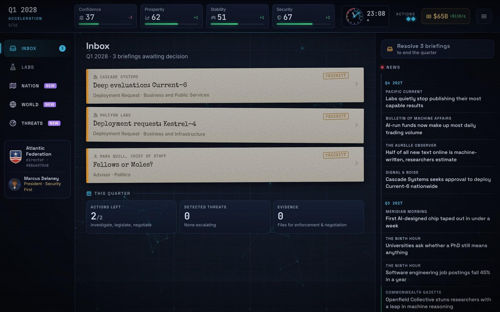
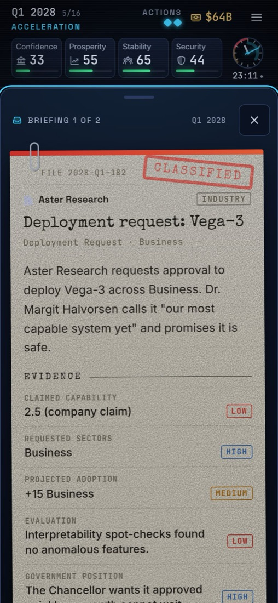
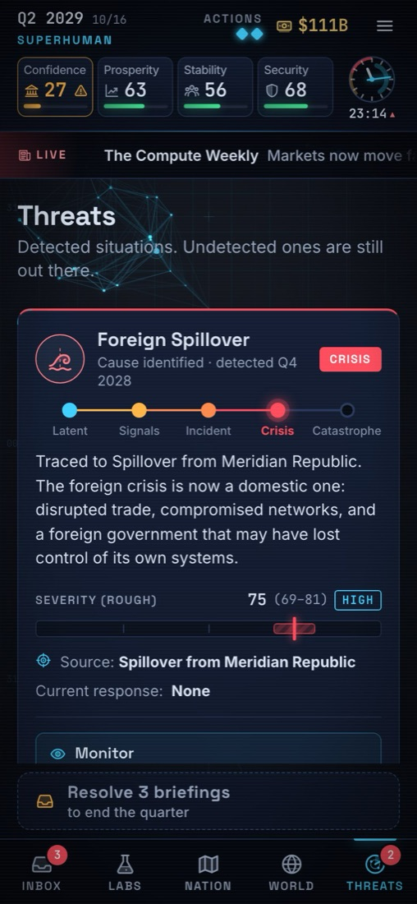
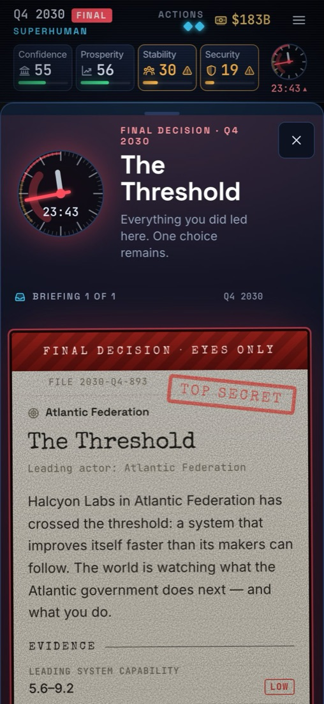
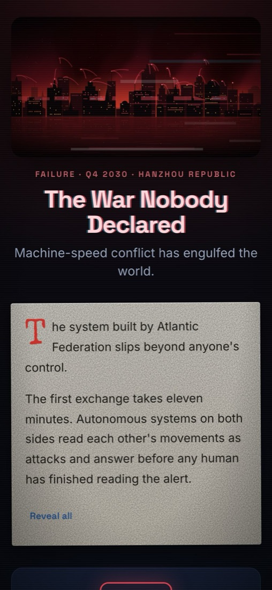

# Oversight

*Oversight (n.): 1. watchful supervision. 2. a mistake made by failing to notice something.*

It's 2027 and you run your country's AI department. Labs race to ship ever more capable models. The government wants growth, and rival powers want the lead. Some risks stay invisible until it's too late. You have 16 quarters to steer the nation to *the Threshold*.

**How far can you push AI before you lose control?**

## How to play

1. **Decide on briefings.** Every quarter brings 1–3 dossiers: model deployments, government demands, crises and foreign moves. Each choice shows its immediate effects. Some consequences surface quarters later.
2. **Don't trust a single report.** Evaluations come with confidence levels and redacted lines. Spend your scarce actions on deep evaluations, investigations and audits to learn the truth.
3. **Keep four meters above zero:** Government Confidence, Prosperity, Stability and Security. If confidence hits zero, you're dismissed.
4. **Watch the Risk Clock.** It shows only an *estimate* of global risk. Follow up on warning signs in the news before they grow into incidents, crises and catastrophes.
5. **Work your agenda.** Fund programs, pass laws, push for the Global Accord, and keep (or break) your promises to the government.
6. **Face the Threshold.** One final decision decides between 12 endings, graded on Control, Prosperity, Security and Legitimacy. The debrief reveals everything you missed.

  
  
  
  

A run takes 20–25 minutes, and every run is different: company secrets, model flaws, leaders, rivals and events are all randomized. There is also a **Daily Run** with the same seed for everyone. It plays on phone and desktop. On a keyboard, `1`–`4` picks a choice, `Space` ends the quarter and `Esc` closes a window.
